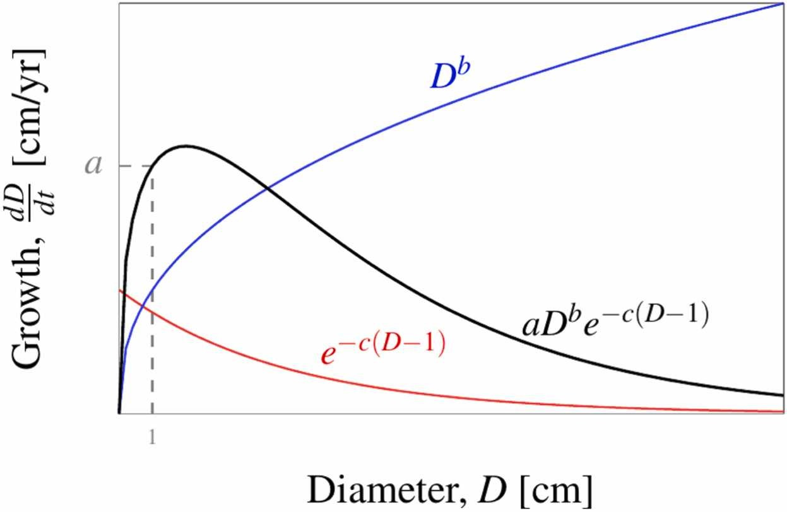

## Abstract

Trees are important ecosystem service providers that improve the physical environment and human experience in cities throughout the world. Since the ecosystem services and maintenance requirements of urban trees change as they grow in time, predictive models of tree growth rates are useful to forecast societal benefits and maintenance costs over a tree’s lifetime. However, many models to date are phenomenological models with good prediction accuracies but lacking biologically interpretable parameters. This has limited our understanding of species life-history strategies for guiding tree species selection for urban plantings. In this study, we fit a diameter growth model to a large municipal tree inventory in Singapore using Bayesian inference and ordinary differential equation solver to obtain both biologically interpretable parameters and transferable predictions. We show that the 126 tree species studied here have growth parameters described by a tradeoff between fast juvenile growth when small versus slower but sustained adult growth when large, corresponding to the well-established “fast–slow” plant economics spectrum. These biological insights generally transferred well across time within the same locality; the transferability across space to a distant dataset in the United States was more variable, but it demonstrates that a biologically informed model produces more realistic predictions compared to phenomenological curve-fitting. Our findings highlight a more tangible way of selecting species for planting based not only on predicted growth, but also intuitive life-history growth characteristics that could be further generalised by functional traits to explore new species suitable for urban forestry.

## Illustrative figure



## Materials

-   [Paper](https://doi.org/10.1016/j.ufug.2025.128982)

## BibTeX citation

``` bibtex
@article{LaiEtAl:2025,
    Author = {Hao Ran Lai, Daniel C. Burcham, James Wei Wang, Daniel B. Stouffer, Damien Qiu Wenjie, Alex Thiam Koon Yee},
    Doi = {10.1016/j.ufug.2025.128982},
    Journal = {Urban Forestry & Urban Greening},
    Month = {7},
    Pages = {128982},
    Title = {Quantifying life-history trade-offs in diameter growth for tropical tree species from a large urban inventory dataset},
    Volume = {112},
    Year = {2025}}
```
