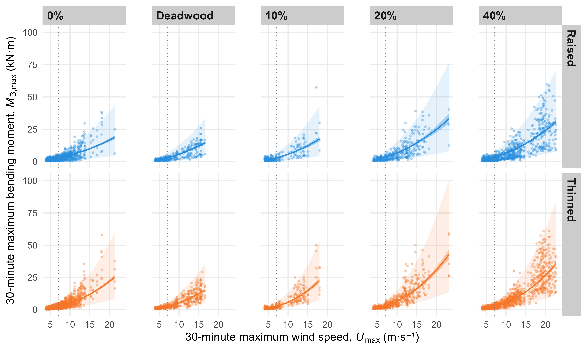

## Abstract

Trees are routinely pruned to mitigate the risk of wind damage, but there are few studies examining changes in wind loads after pruning, especially for large conifers. In this study, ten Colorado spruces (Picea pungens) were monitored before and after a series of pruning treatments. Trees were pruned to raise or thin crowns over a range of severities from 0% to 40%. Wind-induced bending moments were measured using two calibrated displacement transducers installed orthogonally on the lower stem of each tree, allowing the resultant bending moment to be resolved. Using a hierarchical Bayesian model, the relationship between maximum wind speeds and bending moments was quantified as a power law, with random effects accounting for variation in the response among individual trees. The estimated exponents clustered near two, indicating a response close to a rigid bluff body unlike the reconfiguration reported for broadleaf trees. Relative to each tree’s unpruned state, pruning treatments caused modest increases in bending moments at a common wind speed, and the response of bending moment to increasing wind speed steepened for thinned trees, especially at higher severities. The effects were small, however, compared to the variation among individual trees. The exponents also depended on the range of wind speeds analyzed, limiting the general applicability of findings beyond the analyzed range. Ultimately, conventional pruning treatments modestly increased rather than reduced wind-induced bending moments for Colorado spruce, and the practical value of pruning to mitigate risk appeared limited for the studied conditions.

## Illustrative figure

  

## Materials

-   [Paper](https://doi.org/10.1016/j.ufug.2026.129719)
-   [Data](https://doi.org/10.7910/DVN/B0KQFU)

## BibTeX citation

``` bibtex
@article{LeinbachEtAl:2026,
    Author = {David Leinbach, Daniel C. Burcham, Brian Kane},
    Doi = {10.1016/j.ufug.2026.129719},
    Journal = {Urban Forestry & Urban Greening},
    Month = {9},
    Pages = {129719},
    Title = {Modest increase in wind-induced bending moments on raised and thinned Colorado spruce (Picea pungens)},
    Volume = {126},
    Year = {2026}}
```
